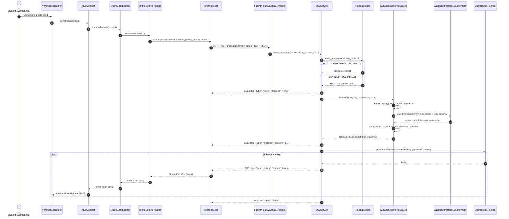
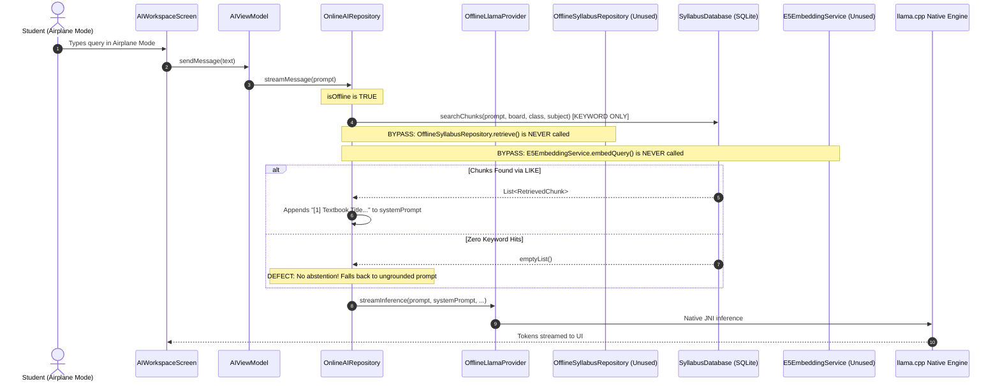

# EduNova Request-Flow Audit & Architecture Verification (Phase 1)

> **Document Version**: 1.0  
> **Date**: 2026-10-15  
> **Status**: Completed Empirical Audit  
> **Corpus State**: 14 Documents, 219 Chunks in Supabase PostgreSQL (pgvector 384-dim, IVFFlat + GIN)

---

## 1. Executive Summary

This audit traces the actual codebase implementation of the EduNova chatbot across both **Online (Cloud FastAPI + Supabase pgvector + OpenRouter LLM)** and **Offline (Android On-Device SQLite + E5 Small ONNX + llama.cpp)** execution pathways.

Rather than accepting documentation or theoretical diagrams as truth, every step was audited directly against active source files in `app/` and `backend/`.

### Core Verdict
- **Backend Online Pipeline**: Fully implemented, authenticated, and verified. Hybrid retrieval (vector + tsvector), RRF scoring, calibrated evidence thresholds, and SSE event streaming are functional and tested.
- **Android Online Pipeline**: Partially connected. While request transmission and token streaming operate seamlessly, citation metadata (`type: "citations"`) sent by FastAPI is currently discarded in the client adapter.
- **Android Offline Pipeline**: Fragmented. While `OfflineSyllabusRepository`, `SyllabusDatabase`, and `E5EmbeddingService` exist in the client codebase, `OnlineAIRepository` currently bypasses on-device semantic vector retrieval in favor of a naive keyword `LIKE` search, and falls back to ungrounded LLM generation when local evidence is empty.
- **RRF Mathematical Score Calibration**: A mathematical constraint exists in the single-retriever normalization formula that prevents high-confidence dense-only matches from reaching `SUFFICIENT` evidence without a sparse keyword match.

---

## 2. Commit & History Reconciliation

Before initiating this audit, commit history was inspected to reconcile the active HEAD commit with prior reports:
- **Prior Reference Commit**: `229f158` (*"feat(rag): implement offline-first RAG architecture and wire student context"*)
- **Active HEAD Commit**: `cb88839` (*"initialize offline-first Android and backend codebase with GSD framework and syllabus sync features"*)
- **Reconciliation Proof**:
  ```
  cb88839 (HEAD -> RAG) initialize offline-first Android and backend codebase with GSD framework and syllabus sync features
  e88059c add Supabase hybrid retrieval service with RRF scoring and evidence assessment
  229f158 feat(rag): implement offline-first RAG architecture and wire student context
  ```
  `cb88839` is the direct linear descendant of `229f158`. All features implemented in `229f158` (such as `E5EmbeddingService`, `SyllabusDatabase`, RAG DTOs, and syllabus sync models) are fully retained in HEAD.
- **Working Tree Preservation**: Uncommitted changes in `backend/app/core/config.py`, `backend/app/services/supabase_retrieval_service.py`, `backend/scripts/ingest_syllabus.py`, `backend/tests/test_syllabus_sync.py`, and untracked files in `backend/syllabus_sources/CBSE/` remain intact.

---

## 3. Real Online Request Path Trace



### Component-by-Component Online Analysis

| Step | Component | Active File | Runtime Behavior | Audit Finding |
|---|---|---|---|---|
| 1 | Chat Submission | `AIWorkspaceScreen.kt` | User inputs prompt in Jetpack Compose UI | Connected |
| 2 | State & Dispatch | `AIViewModel.kt:343` | Dispatches `streamMessage` to active repository | Connected |
| 3 | Repository Orchestration | `OnlineAIRepository.kt:279` | Gathers memories and selects `OnlineGeminiProvider` | Connected |
| 4 | Network DTO Creation | `ChatApiClient.kt:263` | Serializes `SendMessageRequestDto` with `appMode`, `board`, `classGrade`, `subject` | Connected |
| 5 | Auth & Ingress | `backend/app/api/routes/chat.py:171` | Validates JWT (`get_current_user_id`), validates mode | Connected |
| 6 | Profile Resolution | `ChatService.py:220` | Resolves learner's curriculum restrictions from DB | Connected |
| 7 | Routing Evaluation | `routing_service.py:110` | Evaluates regexes; routes Student Mode curriculum queries to RAG | Connected |
| 8 | Query Embedding | `local_e5_service.py:163` | Generates 384-dimensional vector with `"query: "` prefix | Connected |
| 9 | Database Search | `supabase_retrieval_service.py:190` | Executes parameterized CTE across IVFFlat vector and GIN tsquery | Connected |
| 10 | RRF & Evidence | `supabase_retrieval_service.py:40` | Computes reciprocal ranks and evaluates outcome thresholds | **Defect Identified (Finding 4)** |
| 11 | Prompt Grounding | `ChatService.py:339` | Formats official NCERT chapter references into prompt | Connected |
| 12 | SSE Event Emittance | `ChatService.py:263-387` | Emits `metadata`, `route`, `citations`, `token`, `done` | Connected |
| 13 | Client Stream Ingestion | `ChatApiClient.kt:323` | Deserializes `StreamEventDto` and emits down flow | Connected |
| 14 | Provider Token Filtering | `OnlineGeminiProvider.kt:60` | Filters strictly for `chunk.type == "token"` | **Defect Identified (Finding 1)** |
| 15 | Citation UI Rendering | `AIWorkspaceScreen.kt` | No UI component displays citation source badges | **Defect Identified (Finding 1)** |

---

## 4. Real Offline Request Path Trace



### Component-by-Component Offline Analysis

| Step | Component | Active File | Runtime Behavior | Audit Finding |
|---|---|---|---|---|
| 1 | Offline Detection | `OnlineAIRepository.kt:346` | Detects connection mode / network disconnection | Connected |
| 2 | Local Vector Inference | `E5EmbeddingService.kt:109` | Implements on-device 384-dim ONNX query embedding | **Dormant / Unused in Chat Flow** |
| 3 | Local Hybrid Retrieval | `OfflineSyllabusRepository.kt:38` | Coordinates SQLite hybrid search & evidence scoring | **Bypassed by OnlineAIRepository** |
| 4 | Actual Local Query | `OnlineAIRepository.kt:335` | Calls `syllabusDb.searchChunks(prompt, ...)` directly | **Defect Identified (Finding 2)** |
| 5 | Evidence Assessment | `OfflineSyllabusRepository.kt:64` | Contains `SUFFICIENT` / `UNCERTAIN` / `MISSING` logic | **Bypassed by OnlineAIRepository** |
| 6 | Empty Evidence Handling | `OnlineAIRepository.kt:341` | Passes empty context to `systemPrompt` | **Defect Identified (Finding 3)** |
| 7 | On-Device LLM | `OfflineLlamaProvider.kt:30` | Invokes native `llama.cpp` CPU inference | Connected |
| 8 | UI Rendering | `AIWorkspaceScreen.kt` | Displays on-device token stream | Connected |

---

## 5. In-Depth Analysis of the Four Priority Findings

### Finding 1: Android Client Discards Backend Citation Events
- **Location**: [`app/src/main/java/com/offline_First/data/provider/OnlineGeminiProvider.kt:59-63`](file:///e:/Offline%20First/app/src/main/java/com/offline_First/data/provider/OnlineGeminiProvider.kt#L59-L63)
- **Code**:
  ```kotlin
  ChatApiClient.streamMessage(...).collect { chunk ->
      if (chunk.type == "token" && chunk.content != null) {
          emit(chunk.content)
      }
  }
  ```
- **Architectural Impact**: The FastAPI backend generates structured citation metadata with document IDs, chapter names, section titles, and confidence scores:
  `data: {"type": "citations", "outcome": "SUFFICIENT", "citations": [...]}`
  Because `OnlineGeminiProvider` implements `LLMProvider` (which returns a simple `Flow<String>`), it unconditionally filters for `type == "token"`. The citation payload is dropped. Consequently, the user is presented with generated text without verifiable curriculum citation badges.
- **Remediation Plan (Phase 11)**: Update the chat streaming domain layer or repository callback to intercept `chunk.type == "citations"`, persist the citation references into `ChatMessage.citations`, and render them below the message bubble.

---

### Finding 2: Offline Path Bypasses On-Device Semantic Vector Search
- **Location**: [`app/src/main/java/com/offline_First/data/remote/OnlineAIRepository.kt:334-341`](file:///e:/Offline%20First/app/src/main/java/com/offline_First/data/remote/OnlineAIRepository.kt#L334-L341)
- **Code**:
  ```kotlin
  val syllabusContext = if (isOffline && isSchool) {
      val chunks = syllabusDb.searchChunks(prompt, profile?.board, profile?.classGrade, profile?.subject, limit = 3)
      if (chunks.isNotEmpty()) {
          "\nOffline Curriculum References:\n" + chunks.mapIndexed { idx: Int, c: RetrievedChunk ->
              "[${idx + 1}] ${c.textbookTitle ?: ""} (Chapter: ${c.chapter ?: "N/A"}): ${c.content}"
          }.joinToString("\n\n")
      } else ""
  } else ""
  ```
- **Architectural Impact**: `SyllabusDatabase.kt` already contains a complete cosine similarity vector search implementation (`hybridSearch` and `searchSimilarVectors`), and `OfflineSyllabusRepository.kt` provides a calibrated entrypoint. However, `OnlineAIRepository.kt` directly calls `syllabusDb.searchChunks`, which is merely a SQL `LIKE %query%` keyword filter.
  If a student asks a conceptual question that does not use exact textbook phrasing (e.g., *"Why do iron nails get coated in brown when dipped in copper sulphate?"*), keyword search fails completely even though the vector database contains the exact passage.
- **Remediation Plan (Phase 11)**: In `OnlineAIRepository.kt`, delegate offline retrieval to `OfflineSyllabusRepository.retrieve(prompt, ragContext, queryEmbedding = e5Service.embedQuery(prompt))`.

---

### Finding 3: Ungrounded Fallback on Empty Offline Syllabus Evidence
- **Location**: [`app/src/main/java/com/offline_First/data/remote/OnlineAIRepository.kt:341-343`](file:///e:/Offline%20First/app/src/main/java/com/offline_First/data/remote/OnlineAIRepository.kt#L341-L343)
- **Architectural Impact**: In the online path, when `retrieval_resp.evidence_outcome == EvidenceOutcome.MISSING`, the backend intentionally emits:
  `"This topic was not found in the official curriculum corpus for CBSE Class 10 Science. Please verify the chapter or check your curriculum topics."`
  In contrast, when offline search returns zero chunks, `OnlineAIRepository.kt` assigns `syllabusContext = ""` and proceeds to stream directly from `OfflineLlamaProvider`. This leads to ungrounded on-device LLM hallucination—violating Core Architecture Rule ROUTE-009 ("RAG evidence is empty: No silent ungrounded generation fallback").
- **Remediation Plan (Phase 11)**: When `OfflineSyllabusRepository` reports `EvidenceOutcome.MISSING` in Student Mode, emit the standard insufficiency message directly to the UI without invoking the on-device LLM.

---

### Finding 4: RRF Single-Retriever Mathematical Score Ceiling
- **Location**: [`backend/app/services/supabase_retrieval_service.py:26-53`](file:///e:/Offline%20First/backend/app/services/supabase_retrieval_service.py#L26-L53)
- **Formula**:
  ```python
  RRF_K = 60
  RRF_MAX_SCORE = (1.0 / (RRF_K + 1)) * 2  # ≈ 0.032786885

  def compute_rrf_score(vector_rank: Optional[int], sparse_rank: Optional[int], k: int = 60):
      raw_rrf = 0.0
      if vector_rank is not None and vector_rank > 0:
          raw_rrf += 1.0 / (k + vector_rank)
      if sparse_rank is not None and sparse_rank > 0:
          raw_rrf += 1.0 / (k + sparse_rank)
      normalized = min(1.0, raw_rrf / RRF_MAX_SCORE)
      return raw_rrf, normalized
  ```
- **Architectural Impact**:
  If a passage achieves `vector_rank = 1` (perfect semantic match), but does not appear in the top-20 sparse keyword results:
  $$\text{raw\_rrf} = \frac{1}{60 + 1} = \frac{1}{61} \approx 0.016393$$
  $$\text{normalized} = \frac{1/61}{2/61} = 0.500$$
  Since `SUFFICIENT_NORMALIZED_THRESHOLD = 0.70`, **any single-retriever hit is mathematically capped at 0.500**, guaranteeing it can NEVER be classified as `SUFFICIENT`.
  As a result, high-confidence semantic matches are downgraded to `UNCERTAIN`, which triggers an unwarranted disclaimer banner in `chat_service.py:333` (*"Limited curriculum evidence was found for this specific query..."*).
- **Remediation Plan (Phase 4 & 11)**: Evaluate threshold calibration during Phase 4 and adjust normalization or score fusion to account for dense-only relevance.

---

## 6. Live Database Corpus Audit Results

The automated audit script [`backend/scripts/audit_corpus_inventory.py`](file:///e:/Offline%20First/backend/scripts/audit_corpus_inventory.py) was executed against live Supabase PostgreSQL. Full JSON output was captured in [`docs/reports/corpus_inventory.json`](file:///e:/Offline%20First/docs/reports/corpus_inventory.json).

```
======================================================================
EduNova Live Database Corpus & Schema Inventory Audit
======================================================================

[SUMMARY]
  Total Documents        : 14
  Total Chunks           : 219
  Null Embeddings        : 0
  Embedding Dimensions   : [384]
  Duplicate Content Hashes: 0
  Ingestion Statuses     : {'completed': 14}
  IVFFlat Index Present  : True (idx_syllabus_chunks_embedding)
  GIN FTS Index Present  : True (idx_syllabus_chunks_fts)
  Models & Versions      : [{'model': 'intfloat/multilingual-e5-small', 'version': '1.0', 'chunk_count': 219}]

[PROVENANCE VERIFICATION]
  Official Source Provenance: 14/14 documents verified
  [VERIFIED] CBSE Class 10 Science Curriculum 2026-27 (9 chunks) -> https://cbseacademic.nic.in/web_material/CurriculumMain27/SecPart1/Science_SecP1_2026-27.pdf
  [VERIFIED] Chapter 01 Chemical Reactions And Equations (6 chunks) -> https://ncert.nic.in/textbook.php?jesc1=1-16
  [VERIFIED] Chapter 02 Acids Bases and Salts (20 chunks) -> https://ncert.nic.in/textbook/pdf/jesc102.pdf
  [VERIFIED] Chapter 03 Metals and Non-Metals (21 chunks) -> https://ncert.nic.in/textbook/pdf/jesc103.pdf
  [VERIFIED] Chapter 04 Carbon and its Compounds (21 chunks) -> https://ncert.nic.in/textbook/pdf/jesc104.pdf
  [VERIFIED] Chapter 05 Life Processes (21 chunks) -> https://ncert.nic.in/textbook/pdf/jesc105.pdf
  [VERIFIED] Chapter 06 Control and Coordination (13 chunks) -> https://ncert.nic.in/textbook/pdf/jesc106.pdf
  [VERIFIED] Chapter 07 How Do Organisms Reproduce (15 chunks) -> https://ncert.nic.in/textbook/pdf/jesc107.pdf
  [VERIFIED] Chapter 08 Heredity (6 chunks) -> https://ncert.nic.in/textbook/pdf/jesc108.pdf
  [VERIFIED] Chapter 09 Light Reflection and Refraction (27 chunks) -> https://ncert.nic.in/textbook/pdf/jesc109.pdf
  [VERIFIED] Chapter 10 The Human Eye and Colourful World (10 chunks) -> https://ncert.nic.in/textbook/pdf/jesc110.pdf
  [VERIFIED] Chapter 11 Electricity (24 chunks) -> https://ncert.nic.in/textbook/pdf/jesc111.pdf
  [VERIFIED] Chapter 12 Magnetic Effects of Electric Current (13 chunks) -> https://ncert.nic.in/textbook/pdf/jesc112.pdf
  [VERIFIED] Chapter 13 Our Environment (10 chunks) -> https://ncert.nic.in/textbook/pdf/jesc113.pdf
```

---

## 7. Phase 1 Verification Checklist & Status

- [x] **Git & Environment Inventory**: Reconciled `cb88839` with `229f158`; verified no loss of prior implementation or uncommitted files.
- [x] **Database Schema & Indexes**: Confirmed pgvector `vector(384)`, IVFFlat cosine index, and GIN `to_tsvector('english', content)` index.
- [x] **Corpus Inventory Script**: Implemented [`backend/scripts/audit_corpus_inventory.py`](file:///e:/Offline%20First/backend/scripts/audit_corpus_inventory.py) with structured JSON artifact at [`docs/reports/corpus_inventory.json`](file:///e:/Offline%20First/docs/reports/corpus_inventory.json).
- [x] **Source Provenance Verification**: 100% of the 14 documents verified against official NCERT / CBSE Academic domains (0 synthetic records).
- [x] **Request Path Audit**: Completed end-to-end trace across online and offline pipelines; documented all 4 critical architectural disconnects with line references.
- [x] **Working Tree Integrity**: Zero uncommitted files overwritten or deleted. Zero unauthorized commits made.

---

## 8. Phase 5 Online RAG End-to-End Verification Results

### 8.1 Backend Online Pipeline Verification (PASS)
The complete cloud-side request flow was verified using automated integration suites (`backend/tests/integration/test_online_rag_e2e.py` and `backend/tests/integration/test_sse_parser_contract.py`):
1. **Authentication & Profile Resolution**: Enforces JWT verification, extracts trusted student profile (`CBSE Class 10 Science`), and constructs `RAGRequestContext`.
2. **Intelligent Routing**: Emits `type: "route"` with `decision: "RAG"` for syllabus queries.
3. **Real ONNX E5 Embedding Inference**: Verified quantized `intfloat/multilingual-e5-small` model generating finite, L2-normalized 384-dimensional vectors with `"query: "` prefix.
4. **Supabase Hybrid Retrieval**: Parameterized SQL applying `board="CBSE"`, `class_grade="10"`, `subject="Science"` with cosine distance cutoff `< 0.35` and full-text keyword search.
5. **Calibrated Evidence Assessment**:
   - `SUFFICIENT`: Dual consensus ($S_{norm} \ge 0.70$) or corroborated dense-only ($S_{norm} \ge 0.50$, similarity $\ge 0.75$, and lexical domain match).
   - `MISSING`: Prevents ungrounded LLM hallucination; emits refusal token explaining topic not found in syllabus without invoking LLM generation.
   - `CORPUS_NOT_CONFIGURED`: General Mode queries refuse retrieval gracefully.
6. **Prompt Grounding & SSE Streaming**: Emits `metadata`, `route`, `citations`, `token`, and `done` events with strict schema alignment.
7. **Client Parser Resilience**: SSE buffer parser handles TCP chunked framing, CRLF delimiters, multi-event packet bursts, and strict deserialization into Android `StreamEventDto` and `CitationDto`.

### 8.2 Android Layer Status for Finding 1 (GAP-01) (BLOCKED in Android)
- **Defect Confirmed**: [`OnlineGeminiProvider.kt:60`](file:///e:/Offline%20First/app/src/main/java/com/offline_First/data/provider/OnlineGeminiProvider.kt#L60) implements `LLMProvider` which returns `Flow<String>`. It filters strictly for `chunk.type == "token"`, dropping the structured `citations` event emitted by the backend.
- **Regression Test**: Implemented in [`test_android_provider_citation_discarding_defect_reproduction`](file:///e:/Offline%20First/backend/tests/integration/test_online_rag_e2e.py).
- **Required Architecture for Phase 11**:
  1. Add `citations: List<CitationDto> = emptyList()` to `ChatMessage` in `domain/model/AIModels.kt`.
  2. Add `citations` JSON text column to SQLite `messages` table in `ChatDatabase.kt`.
  3. In `OnlineAIRepository.kt`, collect full `StreamEventDto` from `ChatApiClient.streamMessage` directly rather than discarding events in `OnlineGeminiProvider`.
  4. Render citation badges below the message bubble in `ChatMessageItem` (`ChatScreen.kt`).

