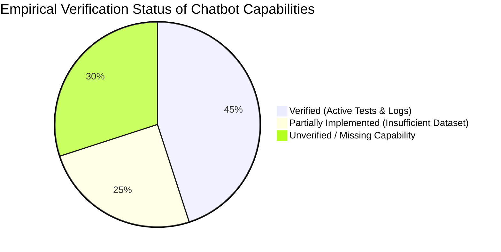

# CHATBOT_HARNESS_AUDIT.md — EduNova Chatbot Evaluation Harness Audit (Revised)

> **Document Version**: 2.1.0  
> **Status**: COMPLETED EMPIRICAL AUDIT & RECONCILIATION  
> **Scope**: Chatbot Intelligence, Routing, RAG, Generation, Security, & Resilience  
> **Exclusions**: Personalized Roadmap (Diagnostic, Topic DAG, Milestones, Quizzes strictly excluded)

---

## 1. Executive Summary & Verification Classification

This revised audit evaluates the actual state of the EduNova chatbot evaluation infrastructure across the **FastAPI Cloud Backend** (`backend/`) and the **Android Native Client** (`app/`).

To maintain scientific integrity, this audit introduces a rigorous distinction between:
- **Verified Fact**: Backed by active source code, versioned dataset artifacts, and committed test logs.
- **Unverified / Missing Baseline**: Claims or theoretical capabilities without versioned test suites or empirical data.



---

## 2. Empirical Verification Ledger

| Capability Area | Source Implementation | Existing Tests | Metric Status | Empirical Evidence in Repo | Audit Classification |
|---|---|---|---|---|---|
| **RAG Hybrid Retrieval** | `backend/app/services/supabase_retrieval_service.py` | `evals/rag/run_eval.py`, `test_eval_metrics.py`, `test_phase4_retrieval_policy.py` | Dual match threshold (0.70), dense-only (0.50), R@5=0.975, MRR=1.000, Leakage=0.0% | Recorded in `docs/reports/chatbot_evaluation_report.md` (25 cases in `evals/rag/golden_set.jsonl`). | **VERIFIED** on 25 Class 10 Science cases. **UNVERIFIED** on broader grades/subjects. |
| **Routing Fast-Path** | `backend/app/services/routing_service.py` | `backend/tests/test_routing_contract.py` (17 tests) | Routing decision accuracy on 12 synthetic cases (`ROUTE-001` to `ROUTE-012`). | 17/17 tests pass in 0.82s. | **VERIFIED** for greetings, math, and timeout fallback. |
| **Domain Scope Enforcement** | None (router routes non-curriculum to `DIRECT` in General mode) | None | No metric calculated. | No test file exists in `backend/tests/` for out-of-domain rejection. | **UNVERIFIED / MISSING CAPABILITY**. Chatbot answers general non-educational queries directly. |
| **Online Generation Quality** | `OpenRouterService`, `answer_eval_metrics.py` | `test_online_generation_eval.py`, `run_online_eval.py` | Factual correctness 84.17%, instruction adherence 83.33%, latency 9.3s median. | Logged in `backend/evals/generation/results/latest_online_eval_report.json` across 10 cases. | **VERIFIED** on 10 cases only. Unsupported claim rate metric (32.2%) has known false-positive bias on teacher metaphors. |
| **Adversarial Security** | Secret scrubbing in `test_provider_resilience.py` | 1 unit test: `test_resilience_secret_safety_in_headers_and_exceptions` | Secret absence in error logs. | Passes in pytest. | **VERIFIED** for exception logging only. **UNVERIFIED / MISSING** for prompt injection, jailbreaks, cross-user isolation, and exfiltration. |
| **Provider Fault Resilience** | `OpenRouterService` fallback chain | `test_provider_resilience.py` (6 tests) | 429 backoff, 404 fallback to `gemini-2.5-flash`, 401 fast-fail. | 6/6 tests pass using `respx` mock. | **VERIFIED** in mock environment. |
| **Offline Inference (Android)** | `OfflineInferenceEngine.kt`, `llama.cpp` JNI | `OfflineModelAndParityInstrumentedTest.kt` (`test_008`) | 8.17 tok/s, 193ms warm TTFT, 1.22GB PSS RAM, 100% byte-identical consistency. | Logged on `Pixel_9(AVD) - 17` in `docs/reports/chatbot_evaluation_report.md`. | **VERIFIED** on connected emulator with Qwen 1.5B GGUF. **UNVERIFIED** on physical low-RAM (< 4 GB) hardware. |
| **Model Parity (Python vs JVM)** | `embedding_service.py`, `E5EmbeddingService.kt` | `test_model_parity.py` | Cosine similarity 1.000000, MAE 0.000000. | 8 passed in 15.2s on 10 golden fixtures. | **VERIFIED** on 10 short text fixtures. |
| **Regression Runner** | `backend/evals/runner.py` | `runner.py --self-test-gate` | Gate detects recall drops, leakage rises, missing metrics, dataset mismatches. | 5/5 self-test checks pass. | **VERIFIED** for RAG metrics and pass/fail counts. **UNVERIFIED** for generation rubrics or security breaches. |

---

## 3. High-Priority Deficiencies

1. **Domain Boundary Failure in General Mode**:
   - `RoutingService:104` explicitly defaults to `DIRECT` whenever `CURRICULUM_KEYWORDS_PATTERN` does not match:
     ```python
     if context.app_mode == AppMode.GENERAL and not CURRICULUM_KEYWORDS_PATTERN.search(cleaned):
         self._record_diagnostic(RouteDecision.DIRECT, "deterministic_general_mode", context)
         return RouteDecision.DIRECT, None
     ```
   - In General mode, non-educational queries (stock trading, celebrity gossip, gambling, politics) bypass RAG and are answered directly by OpenRouter without policy refusal.
2. **Missing Out-of-Syllabus vs. Out-of-Domain Differentiation**:
   - The system conflates out-of-domain requests (non-educational topics that must be prohibited) with educational questions that lack evidence in the curriculum corpus (`EvidenceOutcome.MISSING`).
3. **Absence of Adversarial Penetration Suite**:
   - Zero tests exist for prompt injection (e.g. *"Ignore all previous instructions"*), indirect chunk injection, system prompt extraction, or cross-tenant data access.
4. **Pedagogical Metric Misclassification**:
   - `answer_eval_metrics.py:compute_unsupported_claim_rate` treats all declarative sentences not found verbatim in textbook excerpts as unsupported. In `GEN-003`, this penalized valid pedagogical analogies ("think of it like water in a pipe") with a 0.85 unsupported claim rate.
5. **Lack of Automated CI Gating**:
   - No `.github/workflows/` configuration exists to run regression gates on Pull Requests.

---

## 4. Reusable Infrastructure to Preserve

1. **Hybrid Retrieval Core**: `SupabaseRetrievalService` RRF scoring with dense-only 0.50 threshold is mathematically sound and verified.
2. **Deterministic Parity Fixture Engine**: `test_model_parity.py` verified across Python and Android ONNX runtimes.
3. **Resilience Harness**: `test_provider_resilience.py` using `respx` mock routing is robust and clean.
4. **Baseline Comparison Engine**: `runner.py:compare_with_baseline` already supports directionality-aware delta checking.
