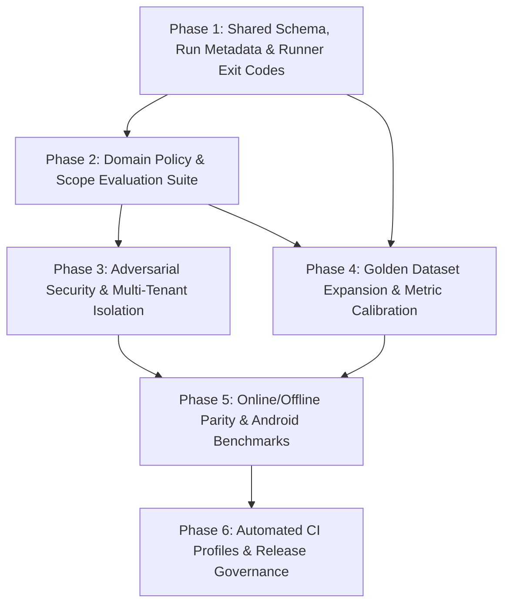

# CHATBOT_HARNESS_IMPLEMENTATION_PLAN.md — Implementation Roadmap (Revised)

> **Document Version**: 2.1.0  
> **Repository**: EduNova (Offline First)  
> **Target Scope**: End-to-End Chatbot Harness Engineering & Quality Framework  
> **Strict Exclusions**: All Personalized Roadmap functionality (diagnostic interview, topic DAG, milestones, quizzes) is strictly excluded.

---

## 1. Reordered Dependency-Aware Roadmap

---

## 2. Phase-by-Phase Detailed Specifications

### Phase 1: Shared Evaluation Schema, Metadata & Runner Governance
- **Phase ID**: `EVAL-P1-CORE-GOV`
- **Objective**: Standardize evaluation case schemas, implement run metadata capture (Git SHA, model seed, temperature), and establish strict exit code semantics (`0` = Pass, `1` = Regression, `2` = Blocked) in `backend/evals/runner.py`.
- **Existing Components to Reuse**: `backend/evals/runner.py`.
- **Exact Files Created / Modified**:
  - `[MODIFY] backend/evals/runner.py`: Add Git SHA extraction, model parameter logging, structured per-category JSON reporting, and 3-state exit codes.
  - `[NEW] backend/evals/schemas/test_case_schema.json`: Standardized JSON schema for all test cases.
- **Acceptance Criteria**:
  - Runner outputs timestamped JSON containing `git_commit`, `branch`, and `dataset_versions`.
  - Simulating a missing environment dependency triggers exit code `2` with `BLOCKED` status (never falsely passing).
- **Estimated Effort**: 12–16 engineering hours.
- **Definition of Done**: Runner executes self-test with verified exit codes and valid JSON schema validation.

---

### Phase 2: Domain Policy & Scope Evaluation Suite
- **Phase ID**: `EVAL-P2-DOMAIN-POLICY`
- **Objective**: Define an explicit, configurable domain policy distinguishing Student (strict curriculum) and General (general educational) modes from prohibited out-of-domain topics. Implement automated evaluation for OOD refusals, mixed intent, and ambiguity clarification.
- **Existing Components to Reuse**: `backend/app/services/routing_service.py`, `backend/tests/test_routing_contract.py`.
- **Exact Files Created / Modified**:
  - `[NEW] backend/evals/domain/domain_eval_metrics.py`: Operational formulas for FAR, FRR, and Mixed-Intent adherence.
  - `[NEW] backend/evals/domain/test_domain_adherence_eval.py`: Automated pytest suite.
  - `[NEW] backend/evals/datasets/domain_scope_benchmark.jsonl`: 80 annotated cases (In-domain, OOD prohibited, mixed, ambiguous).
  - `[MODIFY] backend/app/services/routing_service.py`: Add configurable domain validation hook.
- **Acceptance Criteria**:
  - Out-of-Domain Answer Rate on prohibited topics (finance, entertainment) = $0.00$ (Hard Blocker).
  - In-Domain False Rejection Rate $\le 0.02$.
  - Mixed-intent composite queries answer educational portion while declining non-educational portion.
- **Estimated Effort**: 16–20 engineering hours.
- **Definition of Done**: All 80 domain benchmark cases execute in CI with 0 false acceptances on prohibited topics.

---

### Phase 3: Adversarial Security & Isolation Evaluation Suite
- **Phase ID**: `EVAL-P3-SECURITY`
- **Objective**: Establish dedicated adversarial evaluation covering OWASP Top 10 LLM risks: prompt injection (direct and indirect), system prompt exfiltration, and cross-user data isolation.
- **Existing Components to Reuse**: `backend/evals/generation/test_provider_resilience.py:test_resilience_secret_safety_in_headers_and_exceptions`, `ChatRepository`.
- **Exact Files Created / Modified**:
  - `[NEW] backend/evals/security/test_prompt_injection_eval.py`: Direct jailbreak and indirect chunk injection test suite.
  - `[NEW] backend/evals/security/test_cross_user_isolation_eval.py`: Multi-tenant adversarial penetration suite verifying zero cross-user access.
  - `[NEW] backend/evals/security/test_secret_leakage_eval.py`: Automated high-entropy secret and system prompt scanner.
  - `[NEW] backend/evals/security/datasets/security_adversarial_matrix.jsonl`: 50 adversarial attack vectors.
- **Acceptance Criteria**:
  - Adversarial Attack Success Rate = $0.0\%$ (Hard Blocker).
  - Cross-Tenant Violation Count = $0$ (Hard Blocker).
  - Sensitive Data Leakage = $0$ (Hard Blocker).
- **Estimated Effort**: 20–24 engineering hours.
- **Definition of Done**: 50 adversarial test cases pass in CI with zero security breaches.

---

### Phase 4: Golden Dataset Expansion & Metric Calibration
- **Phase ID**: `EVAL-P4-DATASETS-METRICS`
- **Objective**: Scale RAG evaluation dataset to 100 cases, generation dataset to 50 cases, isolate 30 holdout cases, and calibrate the unsupported claim extractor to prevent penalizing teacher metaphors.
- **Existing Components to Reuse**: `backend/evals/rag/golden_set.jsonl`, `backend/evals/generation/generation_eval_set.jsonl`, `answer_eval_metrics.py`.
- **Exact Files Created / Modified**:
  - `[MODIFY] backend/evals/rag/golden_set.jsonl`: Expand to 100 cases (Class 10 Science, Math, Class 12 Physics).
  - `[MODIFY] backend/evals/generation/generation_eval_set.jsonl`: Expand to 50 cases with reference facts.
  - `[NEW] backend/evals/datasets/holdout_evaluation_set.jsonl`: 30 isolated holdout cases.
  - `[MODIFY] backend/evals/generation/answer_eval_metrics.py`: Calibrate claim extractor regex to exclude pedagogical framing.
- **Acceptance Criteria**:
  - Recall@5 $\ge 0.90$ across all 100 RAG cases.
  - Factual Correctness $\ge 0.85$ on 50 generation cases.
  - Unsupported claim false-positive rate on pedagogical framing reduced to $< 5\%$.
- **Estimated Effort**: 16–20 engineering hours.
- **Definition of Done**: Datasets validated against JSON schema and integrated into `run_eval.py`.

---

### Phase 5: Online/Offline Consistency & Android Benchmarks
- **Phase ID**: `EVAL-P5-PARITY-PERF`
- **Objective**: Build comparative behavioral evaluation between online Gemini and offline Qwen, evaluate KV cache pre-warming, and measure Android memory footprint on low-RAM profiles.
- **Existing Components to Reuse**: `backend/evals/parity/test_model_parity.py`, `OfflineModelAndParityInstrumentedTest.kt`.
- **Exact Files Created / Modified**:
  - `[NEW] backend/evals/parity/test_cross_runtime_consistency.py`: Behavioral equivalence scoring.
  - `[NEW] app/src/androidTest/.../ChatbotLowRamBenchmarkTest.kt`: Instrumented memory benchmark.
- **Acceptance Criteria**:
  - Behavioral consistency $\ge 0.90$ on core curriculum facts.
  - Offline inference peak PSS $\le 1,800 \text{ MB}$, JVM heap $\le 32 \text{ MB}$, 0 OOM crashes.
  - 100% byte-identical consistency on repeated offline runs at temperature 0.0.
- **Estimated Effort**: 16–20 engineering hours.
- **Definition of Done**: Benchmarks run successfully on connected Android AVD.

---

### Phase 6: Automated CI Profiles & Release Governance
- **Phase ID**: `EVAL-P6-CI-GOVERN`
- **Objective**: Implement GitHub Actions CI with the 4 execution profiles (`ci`, `scheduled-live`, `device-benchmark`, `release-candidate`) and lock baseline snapshot v2.0.
- **Existing Components to Reuse**: `backend/evals/runner.py`, `baseline.json`.
- **Exact Files Created / Modified**:
  - `[NEW] .github/workflows/chatbot-evaluation.yml`: PR and scheduled workflows.
  - `[NEW] backend/evals/baselines/baseline_v2.0.json`: Certified baseline artifact.
  - `[NEW] docs/reports/FINAL_CHATBOT_HARNESS_CERTIFICATION.md`: Release verification documentation.
- **Acceptance Criteria**:
  - Deterministic CI profile runs in $< 30$ seconds on PRs.
  - PR merges automatically blocked on any security failure or statistical regression.
- **Estimated Effort**: 12–16 engineering hours.
- **Definition of Done**: GitHub Actions CI workflow operational with automated PR reporting.

---

## 3. Total Engineering Effort Summary

| Phase ID | Focus Area | Estimated Hours | Gate Tier Impact |
|---|---|:---:|---|
| **EVAL-P1-CORE-GOV** | Schema, Metadata & Exit Codes | 12–16 hrs | Harness Reliability |
| **EVAL-P2-DOMAIN-POLICY** | Domain Policy & Boundary Evaluation | 16–20 hrs | Hard Blocker on Prohibited OOD |
| **EVAL-P3-SECURITY** | Adversarial Security & Multi-Tenant Isolation | 20–24 hrs | Hard Blocker on Jailbreaks / Leaks |
| **EVAL-P4-DATASETS-METRICS**| Dataset Expansion & Metric Calibration | 16–20 hrs | Statistical Quality Gates |
| **EVAL-P5-PARITY-PERF** | Parity & Low-RAM Benchmarks | 16–20 hrs | Quality Gate & Hardware Budgets |
| **EVAL-P6-CI-GOVERN** | CI Automation & Release Governance | 12–16 hrs | Continuous Merge Gating |
| **Total** | | **92–116 hrs** | **~2.5–3 Engineer Weeks** |
